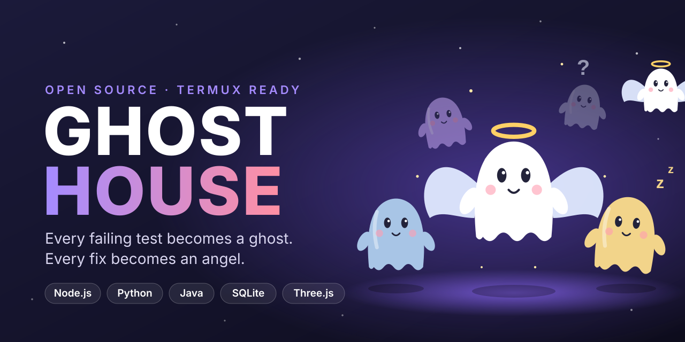

<p align="center">
  <a href="README.md"></a>
  <a href="README.fa.md"></a>
</p>

<p align="center">
  <a href="https://t.me/ArrowDeveloper"></a>
  <a href="https://donate.sudoshz.ir/u/spidey_team"></a>
</p>

<p align="center"></p>

<h1 align="center"> خانه‌ی ارواح (Ghost House)</h1>

<p align="center"><b>هر تست شکسته یه روحه، هر فیکس یه فرشته.</b><br>
داشبورد سه‌بعدی که ریپوهای گیت‌هابت رو اسکن می‌کنه و نشون می‌ده چی خرابه، کجاست، چرا خراب شده و چطور درستش کنی.</p>

---

<p align="center">
  
  
  
  
  
  
  
  
  
</p>

<p align="center">
  <a href="#-شروع-سریع-ترموکس">شروع سریع</a> ·
  <a href="#-چی-گیرت-میاد">امکانات</a> ·
  <a href="#-با-ارواح-آشنا-شو">ارواح</a> ·
  <a href="#-طرز-استفاده">استفاده</a> ·
  <a href="#-ساختار-پروژه">ساختار</a> ·
  <a href="#-حمایت">حمایت</a>
</p>

<div dir="rtl" align="right">

> پروژه‌ی متن‌باز و مستقل است و ارتباطی با GitHub ندارد.

## ✨ چی گیرت میاد

- **خانه‌ی ارواح سه‌بعدی**: باگ یعنی روحِ بیدار، فایل سالم یعنی روحِ خوابیده، و باگ فیکس‌شده یعنی فرشته. با انگشت بچرخون و روی هر کدوم بزن تا جزئیاتش رو ببینی.
- **اتصال به گیت‌هاب**: هر ریپوی عمومی رو با لینک اسکن کن، یا با توکن ریپوهای خودت (حتی خصوصی) رو لیست کن.
- **وضعیت کامل**: امتیاز سلامت، نتیجه‌ی CI، تست‌های شکسته، issueهای باز با برچسب `bug` و کامیت‌های اخیر `fix`.
- **مشکل‌ها بر اساس علت مشترک** گروه‌بندی می‌شن، با فایل، خط، کامیت مشکوک، نویسنده، مدت شکست و پیشنهاد راه‌حل.
- **گراف وابستگی** برای هر فایل: کی ازش استفاده می‌کنه و خودش از کی استفاده می‌کنه.
- **درخت فایل‌ها** با نشان روح و فرشته روی هر فایل.
- **فایل‌های داغ** که اسکنر جاوا رتبه‌بندی می‌کنه (پیچیدگی و تراکم TODO و FIXME).
- **تاریخچه‌ی اسکن‌ها** توی SQLite، تا ببینی پروژه‌ت کم‌کم خوب می‌شه یا نه.
- **بدون هیچ پکیج npm** و ساخته‌شده برای اجرا روی گوشی با ترموکس.

## 👻 با ارواح آشنا شو

| روح | یعنی | ظاهر |
|---|---|---|
| روح Assertion | خروجی اشتباه، assert رد شده | آبی، تک‌عینک، اخمو |
| روح Timeout | کد کند یا گیرکرده | زرد، خواب‌آلود، `zZ` |
| روح NullPointer | مقدار خالی یا گم‌شده | شفاف، `?` |
| روح Flaky | تست ناپایدار که گاهی می‌شکنه | بنفش، چشمک‌زن |
| روح Issue | باگ باز | صورتی، `!` |
| روح خوابیده | فایل سالم، باگی پیدا نشده | آبی‌خاکستری، چشم بسته، `zZ`، نفس‌کشیدن |
| فرشته | تازه فیکس شده | سفید، هاله، بال‌های تکون‌خور |

امتیاز سلامت = `100 - 2 × (جمع شدت ارواح)`

## 🚀 شروع سریع (ترموکس)

</div>

```bash
pkg update && pkg upgrade -y
pkg install nodejs python git openjdk-17 -y      # openjdk اختیاریه (فایل‌های داغ)
git clone https://github.com/rv9cy/ghost-house.git
cd ghost-house
node Server.js
```

<div dir="rtl" align="right">

بعد توی مرورگر گوشی `http://localhost:8080` رو باز کن.

پورت دیگه: `PORT=3000 node Server.js`

## 🧭 طرز استفاده

1. لینک ریپو مثل `https://github.com/user/repo` رو بذار و روی **اسکن** بزن.
2. برای ریپوهای خودت، تب **گیت‌هاب** رو باز کن، توکن شخصی (دسترسی read کافیه) رو بذار و **ذخیره** رو بزن. توکن فقط توی فایل SQLite همون دستگاه می‌مونه. با توکن، لاگ CI هم خونده می‌شه و تست‌های شکسته‌ی pytest و Jest و Go هم لیست می‌شن.
3. روی یه روح یا فرشته بزن و تب **وابستگی‌ها** رو باز کن تا گرافش رو ببینی.

خط فرمان:

</div>

```bash
python3 analyzer.py scan https://github.com/user/repo        # اسکن و ذخیره
pytest --junitxml=report.xml                                   # پروژه‌ی محلی
python3 analyzer.py scan report.xml /path/to/project           # اسکن گزارش pytest
python3 analyzer.py history                                    # اسکن‌های قبلی
```

<div dir="rtl" align="right">

**اسکن چطوری کار می‌کنه؟** خانه‌ی ارواح ریپو رو روی گوشیت clone می‌کنه و کد واقعی رو بررسی می‌کنه (نه حدس):

- **خطاها:** خطای سینتکس توی Python و JavaScript و JSON، و مارکر کانفلیکت مرجِ جامونده.
- **باگ‌ها:** آرگومان پیش‌فرض قابل‌تغییر، `except` و `catch` خالی یا بی‌صدا، `== None` و `debugger` جامونده.
- **امنیت:** `eval`، `shell=True`، خاموش بودن SSL، رمز و کلید داخل کد، فایل `.env` یا کلید کامیت‌شده و `innerHTML` خام.
- **بوی بد کد:** تابع خیلی پیچیده یا بلند، importهای بلااستفاده، تلنبار TODO و FIXME، تست وابسته به زمان یا تصادف، ریپوی بدون تست.
- **CI:** مرحله‌های شکسته‌ی گیت‌هاب اکشنز و issueهای `bug`؛ با توکن، لاگ CI (pytest و Jest و Go) هم خونده می‌شه.
- **اجرای تست:** تیک **اجرای تست** رو بزن تا pytest یا `npm test` یا `go test` روی گوشی اجرا بشه و شکست‌های واقعی بشن روح.
- **فرشته‌ها:** کامیت‌های اخیری که پیامشون `fix` داره.

## 🗂 ساختار پروژه

</div>

```text
ghost-house/
├── Server.js            سرور Node، API، git clone، گراف import
├── analyzer.py          clone، لاگ CI، اجرای تست، ذخیره در SQLite (CLI)
├── inspector.py         تحلیل واقعی کد ریپو
├── SourceScanner.java   رتبه‌بندی فایل‌های داغ (پیچیدگی، TODO)
├── public/
│   ├── index.html       چیدمان صفحه
│   ├── style.css        استایل ریسپانسیو
│   ├── app.js           صحنه‌ی سه‌بعدی، پنل‌ها، گراف وابستگی
│   └── extra.js         اتصال گیت‌هاب، فایل‌های داغ، تاریخچه
├── assets/              پوستر و لوگو
└── data/                دیتابیس SQLite (توی git نمی‌ره)
```

<div dir="rtl" align="right">

API: `GET /api/scan?repo=` · `GET /api/repos` · `GET /api/history` · `POST /api/token`

## 🗺 نقشه‌ی راه

- پشتیبانی از گزارش Jest و JUnit
- ساخت خودکار issue از روی ارواح
- یه GitHub Action که امتیاز سلامت رو توی pull requestها کامنت کنه

## 💖 حمایت

اگه خانه‌ی ارواح وقتت رو نجات داد، می‌تونی ازش حمایت کنی:

- **دونیت:** [https://donate.sudoshz.ir/u/spidey_team](https://donate.sudoshz.ir/u/spidey_team)
- **کانال تلگرام:** [https://t.me/ArrowDeveloper](https://t.me/ArrowDeveloper)
- به ریپو ستاره بده و برای یه دوست بفرستش.

## 📄 مجوز

MIT. فایل [LICENSE](LICENSE) رو ببین.

</div>

<p align="center">ساخته‌شده با دقت توسط <a href="https://github.com/rv9cy"><b>Arrow</b></a></p>
